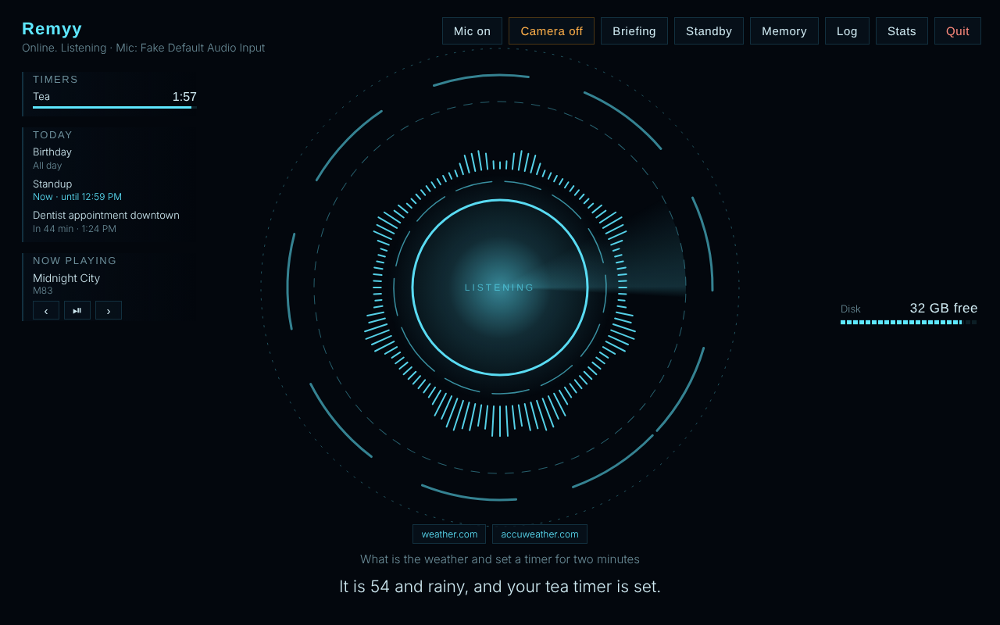

# Remyy

A voice assistant with a glowing HUD for your Mac. Talk to it, and it talks back in real time using Google's Gemini Live API. It can search the web, keep memories, set timers, read your calendar, control your Mac, and (only when you turn the camera on) see you.


*Screenshot uses sample data.*

## What it does

- **Live voice conversation** with interruption, using the Gemini Live API. Pick a voice and preview it.
- **Wake word.** Put it in standby and say "Remyy" to wake it.
- **News and facts lookup** (free, no extra key): Google News headlines plus Wikipedia summaries, with the sources shown as link chips. News needs the helper running; Google News gives headlines only. Optionally add a free Guardian key and/or a free NewsData.io key on the setup screen for article summaries. They are not required. Keys stay in your browser and are only sent to the local helper, which calls those services. Enter your city on the setup screen so weather and local news work without asking.
- **Weather** from [Open-Meteo](https://open-meteo.com/) (free, no key, separate from your Gemini limits). Only the city name you enter is sent to it. Open-Meteo's free service is for non-commercial use.
- **Persistent memory.** Tell it to remember things; it is stored in `~/.remyy/memory.json`, a plain file you can read or edit.
- **Screen vision.** Ask "what's on my screen?" and it captures one screenshot to answer.
- **Calendar and Notes.** Read today's events, add events, find and add notes.
- **Mac controls.** Open or quit apps, volume, mute, media keys, open URLs, notifications, sleep the display.
- **Camera (off by default).** Turn it on from the top bar; hide just the preview if you like.
- **Panels.** Timers, today's calendar, now playing (Spotify or Music), live CPU / memory / disk / temperature / battery stats, a conversation log, and a morning briefing.
- **Confirmation before risky actions** (quit an app, add an event or note, sleep the display), by voice ("yes" / "no") or by clicking. You can switch each one off.
- **Themes:** cyan, green, violet, rose.

## Requirements

- macOS 11 or later (developed on an Apple Silicon Mac; not tested on Intel Macs)
- [Google Chrome](https://www.google.com/chrome/)
- Python 3 (run `xcode-select --install` once if `python3` isn't found)
- A Gemini API key from [Google AI Studio](https://aistudio.google.com/apikey). You pay Google for your own usage; check their current pricing and free-tier limits.
- A microphone. Headphones are strongly recommended so Remyy doesn't hear itself.

## Install

```bash
git clone <this repo's URL>
cd remyy
bash install_remyy_app.sh
```

This builds `~/Applications/Remyy.app` on your Mac (nothing is downloaded or run from elsewhere). Open it from Finder or Spotlight. It starts a small local helper, opens Chrome in full screen with its own profile, and shuts the helper down when you quit (Cmd+Q).

On first launch, paste your Gemini API key on the setup screen and press Start. macOS will ask for permissions as features are used: microphone, camera, Calendar, Notes, screen recording, and automation of System Events, Music and Spotify. Anything you deny just disables that feature.

**Run without the app:** `python3 remyy_server.py` starts the helper and opens Remyy in your default browser at `http://localhost:8000/remyy.html`. Options: `--port 8000 --no-browser`.

**Uninstall:** delete `~/Applications/Remyy.app` and, to remove all data, the folder `~/.remyy`.

## Privacy

- Your voice (and camera frames or screenshots, only when you use those features) is sent to Google's Gemini service. Remyy has no server of its own and sends nothing to the author.
- Screen questions go to Google's Gemini API using your key. News lookups send your search words to Google News and Wikipedia, plus The Guardian and NewsData.io if you add keys. Weather lookups send your city name to Open-Meteo.
- The wake word uses Chrome's built-in speech recognition, which is processed by Google's speech service while standby is on. Turn the wake-word checkbox off to avoid it.
- Your API key is saved in the local storage of Remyy's own Chrome profile (`~/.remyy/chrome-profile`) on your Mac. Anyone with access to your account on the Mac can read it.
- The conversation log is stored in that same browser profile and can be exported or cleared from the **Log** panel, or turned off on the setup screen.
- Calendar event titles, notes, search results and screen contents are treated as data, never as instructions. This reduces, but cannot completely remove, the risk of a prompt-injection attack through content the assistant reads.

## Safety design of the helper

The helper (`remyy_server.py`) listens on `127.0.0.1` only, creates a random token each launch that only the page it serves knows, and checks the `Host` and `Origin` headers so other websites cannot call it. It exposes only a fixed list of actions; there is no shell access or arbitrary script execution. Read it, it is one file.

## Optional: iStatistica temperatures

If you run iStatistica Pro with its web access enabled, Remyy shows CPU temperature and fan speed from it. It looks at `http://localhost:4027/api/` by default; to use another address create `~/.remyy/config.json`:

```json
{ "istatistica_url": "http://localhost:4027/api/" }
```

## Troubleshooting

- **Full screen:** Remyy opens in normal Chrome full screen, so right-click works. Move the mouse to the top of the screen to show the menu bar, or press Ctrl+Cmd+F to leave full screen.
- **Wrong microphone:** pick one from the **Microphone** list on the setup screen. If Chrome still uses another, check Chrome's Settings, Privacy and security, Site settings, Microphone.
- **"Couldn't connect":** check the API key and your internet connection. Google's live model names change; the **Model** field on the setup screen can be edited. Remyy tries a few fallback models.
- **"Port 8765 is being used":** another program holds the port; quit it and relaunch.
- **Logs:** `~/.remyy/launcher.log`.
- **After updating the files,** run `bash install_remyy_app.sh` again.

## Known limits

- The Mac controls, stats and installer are macOS-only.
- This was tested on one Apple Silicon Mac and in a simulated browser environment, not on many Macs or macOS versions. Expect rough edges.
- It depends on Google's preview Live API models and on Chrome features that can change.
- Thinking time before a reply is up to the model.

## Disclaimer

Remyy is an independent project. It is not affiliated with or endorsed by Google, Apple or Spotify. Gemini is a trademark of Google. Use at your own risk; see the license.

## License

MIT. See [LICENSE](LICENSE).

## Update notice

Once a day the setup screen asks GitHub's public API for the latest release of this repository and shows a banner if it is newer than the version in `remyy.html` (`APP_VERSION`). Nothing is sent except that request. Maintainers: when you publish a new GitHub Release, tag it like `v1.2.0` and set `APP_VERSION` to match.
